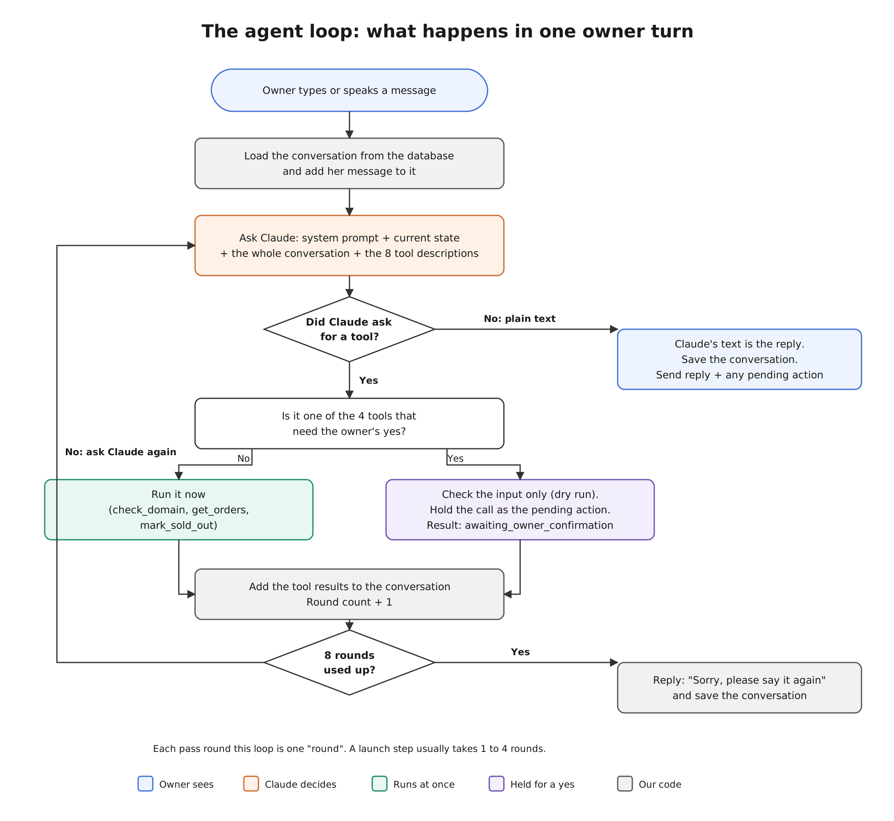
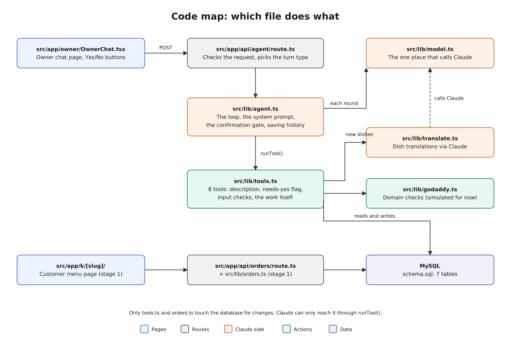
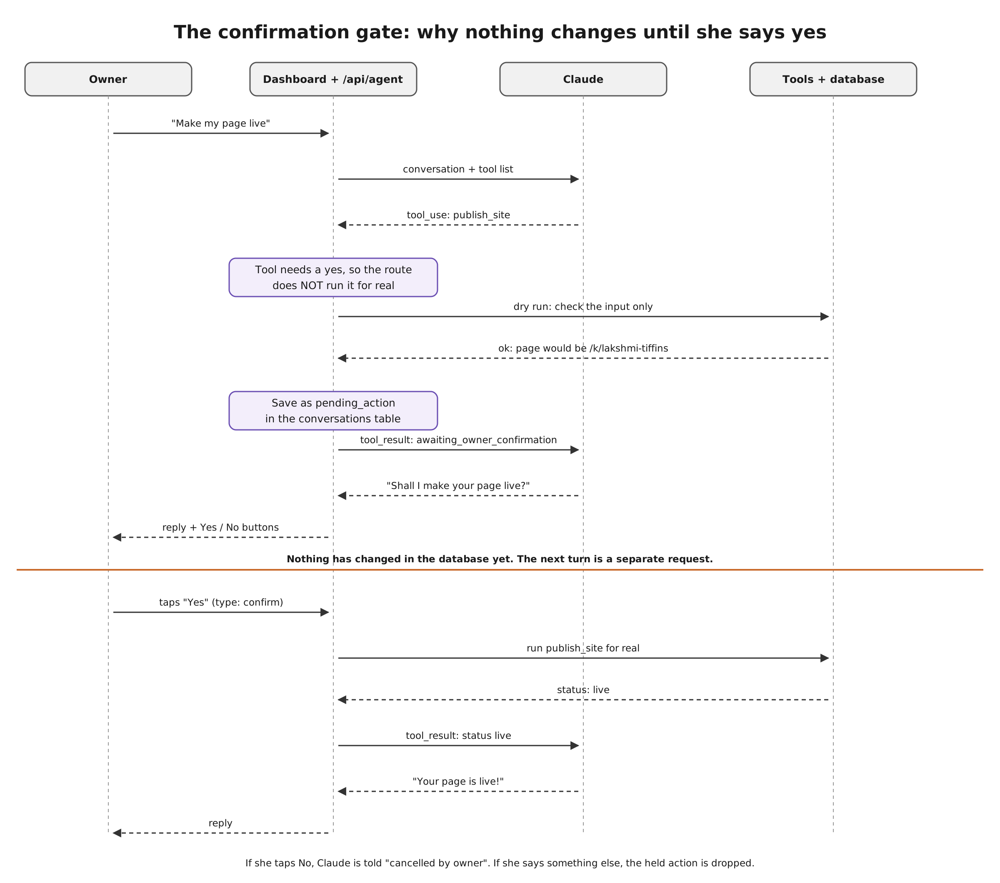
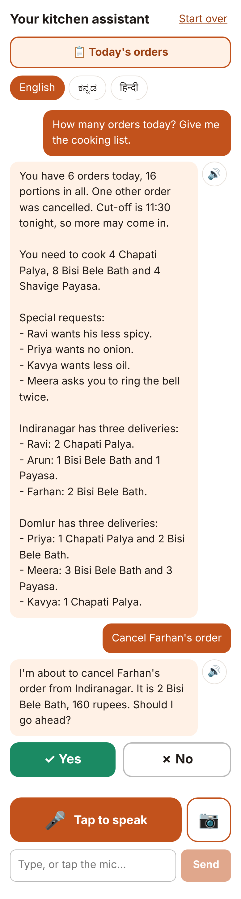

# Stage 2: how the agent works

This guide explains the agent part of the app for someone new to AI engineering. Read it alongside the code.

## 1. What an "agent" is here

A plain chatbot only returns text. An agent can also **act**: it can ask your code to run functions (called **tools**) and then use what they return.

Claude never runs code itself. It works like this:

1. You send Claude the conversation and a list of tools, each with a name, a description and the shape of its input.
2. Claude replies with either text, or a request: "please run `get_orders` with `{date: "2026-11-15"}`". That request is a `tool_use` block.
3. **Your code** runs the function and sends the answer back as a `tool_result` block.
4. Claude reads the result and either asks for another tool or replies in text.

Repeating steps 2 to 4 until Claude replies in text is the **agent loop**.



## 2. The files



| File | Job |
| --- | --- |
| `src/lib/model.ts` | The only place that calls Claude's API. Defines the message and tool types. |
| `src/lib/tools.ts` | The eight tools. Each has a description for Claude, a "needs yes" flag, input checks and the work. |
| `src/lib/agent.ts` | The loop, the system prompt, the confirmation gate and saving the conversation. |
| `src/lib/translate.ts` | Translates dish names with one extra Claude call. |
| `src/lib/godaddy.ts` | Domain checks. Simulated until you add GoDaddy test keys. |
| `src/app/api/agent/route.ts` | `POST /api/agent`, the endpoint the dashboard calls. |
| `src/app/owner/` | The owner's chat page with Yes and No buttons. |
| `tests/agent.test.ts` | Runs the whole launch flow against the database with a scripted stand-in for Claude. |

## 3. A tool, piece by piece

Each tool in `tools.ts` has three parts.

**The definition** is what Claude reads. Claude chooses tools based almost entirely on the `description`, so it says *when* to use the tool, not only what it does. `input_schema` is JSON Schema: it tells Claude the exact shape of the input.

```ts
definition: {
  name: "cancel_order",
  description: "Cancel one customer's order. Find the order_id with get_orders first. If several orders could match, ask her which one.",
  input_schema: { type: "object", properties: { order_id: { type: "integer" } }, required: ["order_id"] },
}
```

**The flag** `needsConfirmation` says whether the owner must approve it first.

**The `run` function** is ordinary TypeScript. It never trusts Claude's input: every field is checked again. If something is wrong it throws a `ToolError` with a plain message. That message goes back to Claude marked `is_error: true`, and Claude corrects itself. The test shows this: Claude sends a price of -5, gets the error back, and retries with 60.

| Tool | Needs yes | Why |
| --- | --- | --- |
| `create_kitchen` | Yes | Writes her business details |
| `check_domain` | No | Only reads |
| `register_domain` | Yes | Would spend money |
| `publish_site` | Yes | Makes the page public |
| `update_menu` | Yes | Customers see it at once |
| `mark_sold_out` | No | Small and easy to undo |
| `get_orders` | No | Only reads |
| `cancel_order` | Yes | Affects a customer |

## 4. The confirmation gate

The most important design choice: **the yes is enforced in code, not by asking Claude nicely in the prompt.** Prompts are instructions a model usually follows; code is a guarantee.



When Claude calls a tool that needs a yes, `agent.ts`:

1. Runs it as a **dry run**, which checks the input but changes nothing.
2. Saves the call in `conversations.pending_action`.
3. Tells Claude `awaiting_owner_confirmation`. Claude then reads the action back to her.
4. Returns the reply with `pending` set, so the dashboard shows Yes and No buttons.

The next request is a separate HTTP call. Yes arrives as `{type: "confirm"}`, a button press, not the word "yes" in free text. Only then does the tool run for real. No sends Claude `cancelled_by_owner`. If she says something else, the action is dropped.

## 5. Three API rules the loop has to respect

Claude's Messages API rejects a conversation that breaks these rules, so `agent.ts` is careful about them.

1. **Every `tool_use` must be answered.** The very next message must hold a `tool_result` with the same `id` for each one, even for held or failed tools.
2. **Roles alternate.** User, assistant, user, assistant. A tool result followed by her new words would be two user messages in a row, so `mergeUserMessages` joins them.
3. **History is trimmed safely.** Only the newest 40 messages are kept, and trimming always starts at a message she typed, never in the middle of a tool call and its result.

`tests/agent.test.ts` checks the first two rules on every request it makes.

## 6. The system prompt and the "current state"

The system prompt (top of `agent.ts`) sets the behaviour: reply in her language, keep it short enough to speak, one question at a time, never invent numbers.

Every round also adds a **current state** block from the database: today's date and time in her time zone, the saved dishes with their ids, and today's menu. Claude has no clock and no memory of the database, so without this it would guess the date or invent dish ids.

## 7. Why the numbers are exact

Counts and totals come from SQL in `get_orders`, and Claude only phrases them. Language models are not reliable at arithmetic, so anything a customer or the owner depends on is computed in code.

## 8. Translations in one call

`translate.ts` uses a technique called **forcing a tool**. It gives Claude a single tool, `save_translations`, and sets `tool_choice` so Claude must call it. Claude's answer then arrives as JSON in a known shape, not as free text you would have to parse. If the call fails, the page falls back to the owner's original dish name.

## 9. Testing without an API key

`model.ts` defines `ModelCall`, a function type. The real app passes `callClaude`. The test passes a stand-in that returns scripted replies. This is called **dependency injection**, and it means the loop, the gate and the database code are all tested for free and the same way every time. What the scripted test cannot check is whether the real Claude makes good decisions. You check that by talking to it on `/owner` once you have a key.

## 10. Running it

```bash
# in .env
ANTHROPIC_API_KEY=sk-ant-...
# optional: CLAUDE_MODEL=claude-sonnet-5-5   (the default)
# optional, for real domain checks: GODADDY_API_KEY=...  GODADDY_API_SECRET=...

npm run test:agent   # scripted test, no key needed
npm run dev          # then open http://localhost:3000/owner
```

## Known gaps

- `/api/agent` has no sign-in yet. Anyone with a conversation token can act for that kitchen. Add owner login before real use.
- `register_domain` saves the name but does not buy it yet. The real GoDaddy purchase call needs contact details and agreements, and is left until you have test keys.
- One owner turn can take several seconds while the loop runs. Streaming the reply would make it feel faster.

## 11. Stage 3: voice

Voice runs entirely in the browser, in `src/app/owner/voice.ts`, so the agent code did not change. The agent still receives text.

- **Speech to text** uses the browser's speech recognition API, set to `kn-IN`, `hi-IN` or `en-IN` from the language buttons. Chrome sends the audio to Google to recognise it, so it needs internet. Words appear live in a dashed bubble while she speaks.
- **Text to speech** uses `speechSynthesis` with a voice installed on the phone for her language. If the phone has none, the page says replies will be shown as text, and nothing fails silently.
- **Fallbacks:** typing always works. If the browser has no speech recognition (Firefox, some in-app browsers), the microphone is replaced by a note.
- **Confirmation stays a button tap.** A misheard "yes" should never publish a page or cancel an order.



What still needs a real phone: recognition accuracy for Kannada and Hindi, and whether the phone has Kannada and Hindi voices installed.
